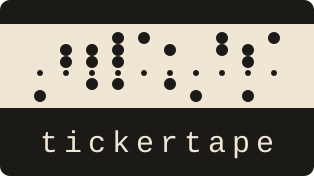

<p align="center"></p>

# Tickertape

A free RSS reader that runs entirely on GitHub. **GitHub Actions** fetches your feeds every few hours and **GitHub Pages** serves them as a plain, old-school HTML site. One OPML file is one list: lists are never merged.

The logo is a strip of five-hole paper tape, the kind old news tickers printed. Its holes spell `TICKERTAPE` in Baudot code (ITA2), and the favicon spells `RSS`.

What you get:

- **One page per OPML file**, with categories and subcategories kept, search, a period filter, unread-only and bookmarkable filtered views.
- **Read state per browser** (nothing is shared with other visitors), with export and import.
- **Edit feeds** (`/admin/`): an OPML editor in the browser that commits to the repository. Sign in with GitHub, or use a token.
- **Save** under any item: opens a pre-filled GitHub issue for your notes. Saved items are listed on the **Saved** page.
- **Feed status**: which feeds fail and why.

```
opml/                    your feed lists (the source of truth)
tickertape.config.json   short names, retention, per-site delays…
scripts/                 feed fetcher and Saved-page builder (Node 22)
src/                     the Astro site (plain HTML pages + a little JavaScript)
auth-worker/             optional sign-in helper for “Connect with GitHub”
.github/workflows/update.yml
```

Fetched items are stored on a separate `data` branch that is overwritten on every run (one commit), so `main` stays clean and the repository doesn’t grow.

---

## 1. Deploy to GitHub (10 minutes)

1. **Create a public repository** at <https://github.com/new>, for example `tickertape`, without a README. It needs to be public: GitHub Pages is free for public repositories, and so are Actions minutes.
2. **Push this folder** from a terminal:
   ```sh
   cd tickertape
   git init
   git add -A
   git commit -m "Tickertape"
   git branch -M main
   git remote add origin https://github.com/YOUR-USERNAME/tickertape.git
   git push -u origin main
   ```
3. **Turn on Pages**: repository **Settings → Pages → Build and deployment → Source: GitHub Actions**.
4. **First run**: **Actions** tab → **Update feeds** → **Run workflow**. It takes one to two minutes.
5. Open **`https://YOUR-USERNAME.github.io/tickertape/`**.

From then on, the workflow runs every 3 hours, and every time a file in `opml/` changes. The workflow re-enables itself on each run, so GitHub’s rule that turns off schedules after 60 days of inactivity in public repositories never kicks in.

If the run fails with a permissions error on “Store data”, go to **Settings → Actions → General → Workflow permissions** and choose **Read and write permissions**.

## 2. Reliable timing with cron-job.org (recommended)

GitHub’s built-in schedule can run late, or be skipped, when GitHub is busy. A free [cron-job.org](https://cron-job.org) job can trigger the workflow on time instead. GitHub’s schedule stays on as a backup.

**a. Create a token that can only start workflows**

1. GitHub → avatar → **Settings → Developer settings → Personal access tokens → Fine-grained tokens → Generate new token**.
2. Name: `cron-job.org`. Expiration: pick a date, and set yourself a reminder to renew it.
3. **Repository access → Only select repositories →** `tickertape`.
4. **Permissions → Repository permissions → Actions: Read and write.** Nothing else.
5. Generate it and copy it (it starts with `github_pat_`).

**b. Create the job**

1. Sign up at <https://console.cron-job.org/signup> and open **Cronjobs → Create cronjob**.
2. **Common** tab:
   - **Title**: `Tickertape update`
   - **URL**: `https://api.github.com/repos/YOUR-USERNAME/tickertape/actions/workflows/update.yml/dispatches`
   - **Execution schedule**: every 2 or 3 hours, at a minute other than :00 (for example `17 */3 * * *` in custom mode)
3. **Advanced** tab:
   - **Request method**: `POST`
   - **Headers** (one per row):

     | Key | Value |
     | --- | --- |
     | `Authorization` | `Bearer github_pat_…` (your token) |
     | `Accept` | `application/vnd.github+json` |
     | `X-GitHub-Api-Version` | `2022-11-28` |
     | `Content-Type` | `application/json` |

   - **Request body**: `{"ref":"main"}`
4. Save, then use **Test run**. GitHub answers **`204 No Content`** when the run starts; check the **Actions** tab. A `401` means the token is wrong or expired; a `403` or `404` means it lacks the Actions permission or the repository.
5. Optionally turn on email notifications for failures.

## 3. “Connect with GitHub” for the editor (optional)

Without this, the editor still works: either offline (changes are downloaded as files), or with a fine-grained token (**Contents: Read and write** on this repository) pasted under “Use a personal access token instead”.

GitHub’s sign-in can’t be completed by a static page: its token endpoint refuses browser requests and requires the app’s secret. So the button needs a tiny helper that holds that secret. It runs for free as a Cloudflare Worker (`auth-worker/worker.js`). It stores nothing; the token only passes through and is handed back to your page in the URL fragment, which never reaches a server.

**a. Create the Worker (to get its URL)**

1. Sign up at <https://dash.cloudflare.com> (free plan).
2. **Workers & Pages → Create → Create Worker**, name it `tickertape-auth`, and **Deploy** the default “Hello World”.
3. **Edit code**, replace everything with the content of `auth-worker/worker.js`, then **Deploy**.
4. Note the Worker URL, like `https://tickertape-auth.YOUR-SUBDOMAIN.workers.dev`.

(Command-line alternative: `cd auth-worker && npx wrangler deploy`, after editing `wrangler.toml`.)

**b. Create a GitHub App**

A GitHub App is better than a classic OAuth app here: it only gets access to the repositories you install it on, with only the permissions you pick.

1. <https://github.com/settings/apps/new>
2. **GitHub App name**: something unique, like `Tickertape YOUR-USERNAME`.
3. **Homepage URL**: your site, `https://YOUR-USERNAME.github.io/tickertape/`.
4. **Callback URL**: `https://tickertape-auth.YOUR-SUBDOMAIN.workers.dev/callback`.
5. Keep **Expire user authorization tokens** ticked. Leave **Request user authorization (OAuth) during installation** unticked.
6. **Webhook**: untick **Active**.
7. **Repository permissions → Contents: Read and write.** Nothing else.
8. **Where can this GitHub App be installed? → Only on this account.** Create it.
9. On the app’s page, copy the **Client ID**, then click **Generate a new client secret** and copy it.
10. Left menu **Install App → Install → Only select repositories →** `tickertape`.

**c. Configure the Worker**

In Cloudflare: your Worker → **Settings → Variables and secrets → Add**:

| Name | Type | Value |
| --- | --- | --- |
| `GITHUB_CLIENT_ID` | Text | the Client ID |
| `GITHUB_CLIENT_SECRET` | Secret | the client secret |
| `ALLOWED_ORIGINS` | Text | `https://YOUR-USERNAME.github.io` |

Deploy again so the variables apply. `ALLOWED_ORIGINS` makes sure tokens can only be sent back to your own site.

**d. Tell the site about it**

GitHub repository → **Settings → Secrets and variables → Actions → Variables → New repository variable**: name `AUTH_WORKER_URL`, value `https://tickertape-auth.YOUR-SUBDOMAIN.workers.dev`. (Or put it in `tickertape.config.json` under `auth.workerUrl`.) Run the workflow once: **Edit feeds** now shows **Connect with GitHub**.

GitHub App user tokens expire after a few hours; sign in again when the editor asks.

---

## Using it

- **Reading**: filters live in the address (`#c=…&p=30&q=cobol`), so a filtered view can be bookmarked. Opening an item marks it read. Keyboard: `j` / `k` move, `o` open, `m` read or unread, `s` save, `/` search.
- **Editing feeds**: add, rename, move (drag and drop, or Move up / Move down / Move to…), and remove feeds and categories; create, import or delete lists; templates for Google News alerts, Hacker News searches, subreddits, GitHub releases, arXiv, DEV and Stack Overflow tags; several URLs at once; duplicate detection; undo (Ctrl+Z); OPML preview. **Save to GitHub** makes a single commit for all changed files and the site rebuilds in two to three minutes.
- **Saving items**: “save” opens a pre-filled issue with *Notes* and *Why it matters* sections. Submit it and it appears on **Saved** after the next build. Only issues **you** open with the `saved` label count (the label is created automatically). Closing the issue removes the item.

## Settings (`tickertape.config.json`)

| Key | What it does |
| --- | --- |
| `siteTitle` | name in the browser tab |
| `timeZone` | time zone for dates rendered at build time (the reader itself uses the visitor’s) |
| `views.<file>.label` | short name in the menu (defaults to the OPML title); key order sets the menu order |
| `retentionDays` | how long items are kept (60) |
| `keepLatestPerFeed` | minimum items kept per feed, even old ones (10) |
| `maxItemsPerFeed` | cap per feed (300) |
| `summaryLength` | summary length in characters (320) |
| `hostIntervalsMs` | pause between two requests to the same site (arXiv asks for 3 s) |
| `auth.workerUrl` | sign-in helper URL (or the `AUTH_WORKER_URL` repository variable) |
| `concurrency`, `timeoutMs`, `userAgent` | network settings |

## Known limits

- **The site is public**, and so are your OPML lists (published at `/opml/`). Read state stays in your browser.
- **Some sites block GitHub’s servers**, Reddit in particular and sometimes Medium (errors 403 or 429). They show up on **Feed status**; replace or remove them.
- Summaries are plain text (no images or HTML from feeds), so a feed can never inject scripts into the page.
- Updates every 2 to 3 hours: not real time.

## Local development

```sh
npm ci
npm run fetch      # fetches feeds into ./data
npm run dev        # http://localhost:4321
npm test           # parsers, OPML round trip, sign-in helper
```
